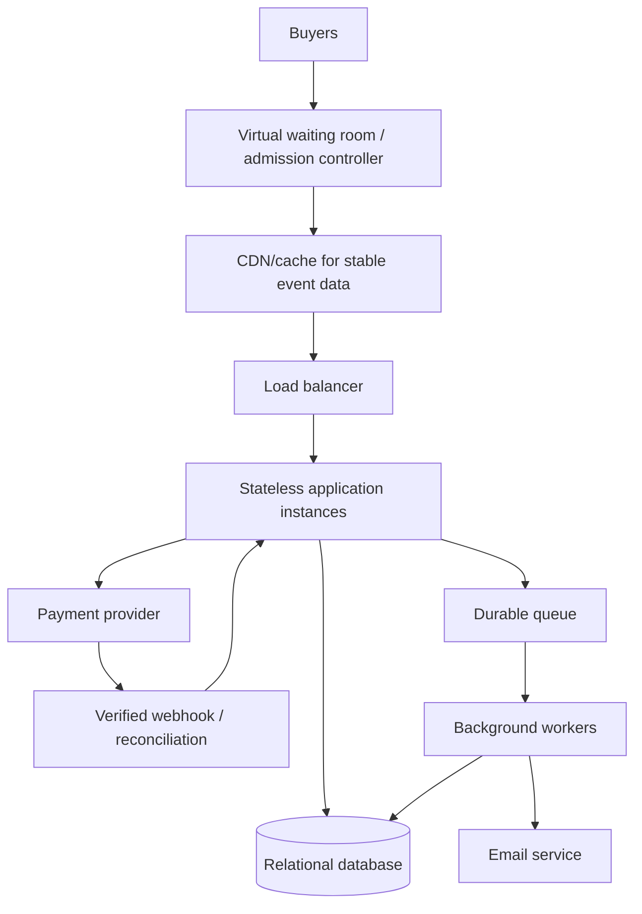

# TicketHub System Design

**Status:** Assignment submission draft. Traffic figures are estimates based on stated assumptions, not measured capacity.

## 1. Requirements

### Functional requirements
1. Users can register/sign in and browse events.
2. Users can view event details, seat maps, prices, and current availability.
3. Authenticated users can request temporary holds on available seats.
4. Users can place an order for seats held by them and initiate payment.
5. The system records payment outcomes and confirms successful orders.
6. Users can view confirmed tickets and order status.
7. Expired holds can be released safely; failed or ambiguous payments are reconciled.
8. Users receive a confirmation email after the order is confirmed.

### Non-functional requirements
- **Correctness:** A physical seat can have at most one active hold and one confirmed sale.
- **Performance:** Browsing and seat selection should remain responsive during high demand; actual latency targets must be established by testing.
- **Fairness:** Sale access follows a published policy and is applied consistently.
- **Reliability:** Orders persist even if email delivery fails; duplicate/delayed payment notifications must not create duplicate tickets.
- **Security:** Authenticate users, authorize access to their own orders, validate input, rate-limit abuse, and never store raw card details.
- **Scalability:** Protect the database and payment provider from a sudden burst of requests.

## 2. Traffic and capacity estimates

### Given
- 2,000,000 registered users.
- 50,000 visitors on a normal day.
- 10 pages per normal-day visitor.
- 5,000 tickets sold per normal day.
- A popular sale attracts 200,000 people trying to buy 20,000 seats within 10 minutes.

### Normal day
Page views per day = 50,000 visitors × 10 pages = **500,000 page views/day**.

Average page-view rate = 500,000 ÷ 86,400 seconds ≈ **5.79 page views/second**. This is a 24-hour average, not a peak.

### Popular sale
**Assumptions:** each participant views 3 pages on average; each page triggers 2 API requests on average; activity is averaged evenly across the 10-minute window.

- Window: 10 × 60 = 600 seconds.
- Page views: 200,000 × 3 = **600,000**.
- Average page-view rate: 600,000 ÷ 600 = **1,000 page views/second**.
- API requests: 600,000 × 2 = **1,200,000**.
- Average API request rate: 1,200,000 ÷ 600 = **2,000 API requests/second**.

The estimated sale page-view rate is approximately 173 times the normal daily average (1,000 ÷ 5.79). If normal traffic also averages two API requests per page, its average is about 11.6 API requests/second, giving a similar ratio under these assumptions.

**Limitations:** arrivals can be bursty; pages generate different numbers of requests; polling, retries, bots, and checkout actions add load. These averages are not peak forecasts or a capacity guarantee. Load tests and monitoring are required. Read traffic and seat-allocation writes stress different system components, so request rate alone does not prove the system can safely sell tickets.

### Workload
- **Reads:** browse events, event details, seat availability, purchased tickets.
- **Writes/state transitions:** create holds, create orders, initiate/record payment, confirm sales, expire/release holds.
- Event descriptions can be cached more aggressively than seat availability. A cache or browser display must never be the final authority for allocating inventory.

## 3. API design

These endpoints are proposed contracts, not implemented routes.

| Method | Endpoint | Purpose |
|---|---|---|
| GET | `/api/v1/events` | Browse/paginate events |
| GET | `/api/v1/events/{eventId}` | Event details |
| GET | `/api/v1/events/{eventId}/seats` | Display seat availability |
| POST | `/api/v1/events/{eventId}/holds` | Atomically request one or more seat holds |
| POST | `/api/v1/orders` | Create an order from the caller's valid hold |
| POST | `/api/v1/orders/{orderId}/payment` | Initiate payment |
| POST | `/api/v1/payments/webhook` | Receive and verify provider payment events |
| GET | `/api/v1/me/tickets` | View the authenticated user's tickets |

### API rules
- The frontend sends HTTP requests; the API is the contract. The backend validates inputs, applies rules, and coordinates the database and payment provider.
- A seat displayed as available may be claimed by someone else before the user submits a hold request. The hold endpoint must recheck and claim it atomically.
- Return `201 Created` when a hold is created, `409 Conflict` when requested seats are no longer available, and a clear pending state when payment has not been verified.
- Require authentication for holds, orders, and tickets; authorize every order access against its owner.
- Use idempotency keys for retried order/payment requests. Verify payment webhooks and deduplicate provider event IDs.
- Do not trust client-supplied prices or a browser redirect as proof of payment. The server uses the stored price and verified provider status.

## 4. Data model

Use a relational database because orders, payments, and seat allocation need transactions and integrity constraints.

| Table | Important fields | Purpose / relationship |
|---|---|---|
| `users` | `id PK`, `email UNIQUE`, `password_hash`, `created_at` | One user can create many orders. |
| `events` | `id PK`, `name`, `venue`, `starts_at`, `sale_opens_at`, `status` | One event has many seats. |
| `seats` | `id PK`, `event_id FK`, `section`, `row_label`, `seat_number`, `price`, `status`, `hold_owner_id FK NULL`, `hold_expires_at NULL` | One row represents one physical seat for one event; unique constraint on (`event_id, section, row_label, seat_number`). |
| `orders` | `id PK`, `user_id FK`, `status`, `total_amount`, `currency`, `idempotency_key`, `created_at` | One user can have many orders; an order groups multiple seats. |
| `order_items` | `id PK`, `order_id FK`, `seat_id FK`, `unit_price`, `status` | One order has many items; each item identifies a seat and preserves its price at purchase time. |
| `payment_attempts` | `id PK`, `order_id FK`, `provider_reference UNIQUE`, `status`, `amount`, `created_at` | An order can have payment attempts; provider references and statuses support reconciliation. |

**Key constraints and rules**
- Primary keys uniquely identify records; foreign keys prevent references to nonexistent users, events, orders, or seats.
- `users.email` is unique; the seat identity tuple is unique within an event.
- Store money as integer minor units (for example, cents) or an exact decimal type, not floating-point.
- `orders.idempotency_key` should be unique within the appropriate user/API scope.
- Seat status is authoritative: `AVAILABLE`, `HELD`, or `SOLD`. A held seat records its owner and expiry; a sold seat is linked to a confirmed order item.
- The application must enforce that an order item cannot sell a seat already sold to another order. A robust implementation can additionally use a dedicated seat-allocation table with a database uniqueness constraint on active allocations. Expired allocation rows must be transitioned to `EXPIRED` before a new active allocation is inserted.
- A user can own many orders; an order has many items; each item references one seat; an event has many seats; an order can have multiple payment attempts.

## 5. Preventing two buyers from getting the same seat

**The backend/database must enforce this, not the frontend.** Alice and Brian can both see a cached seat as available. UI checks improve experience but cannot prevent concurrent requests.

### Hold transaction (database pseudocode)
1. Begin a short database transaction.
2. Lock the requested seat row (for example, `SELECT ... FOR UPDATE`) or perform an atomic conditional update.
3. Recheck that the sale is open and the seat is `AVAILABLE`, or that a previous hold has safely expired.
4. If available, set `status = HELD`, record the holder and expiry time, and create the associated pending order/hold records.
5. Commit promptly. If another request already claimed the seat, return `409 Conflict`.

The lock/conditional update serializes competing claims: the second request must see the committed state and cannot also claim the seat. Keep transactions short; never hold a database lock while waiting for a payment provider.

### Payment and expiry lifecycle
- Proposed states: seat `AVAILABLE → HELD → SOLD`; a safely released/expired hold returns to `AVAILABLE`. Order/payment states separately distinguish `PENDING`, `CONFIRMED`, `FAILED`, `EXPIRED`, and `REFUND_REQUIRED` as appropriate.
- A five-minute hold is a **design assumption**, not a fact given in the brief. It balances checkout time against keeping inventory unavailable.
- On verified payment success, use an idempotent transaction to verify the reservation/order and mark the order and seat allocation confirmed/sold.
- If payment fails, release the hold only after the failure is known and the transition is safe.
- If payment times out or its outcome is unknown, do not immediately release the seat as though payment definitely failed. Reconcile with the provider. Define a bounded pending-payment policy; if a late success can no longer be honoured because the seat was safely reallocated, flag it for refund/manual recovery rather than issuing a duplicate ticket.
- A repeated webhook must not confirm or sell the seat twice. Email is sent after confirmation; email failure does not reverse a confirmed purchase.

## 6. High-level architecture

### Component responsibilities
- **Waiting room/admission controller:** applies the published queue policy and limits admissions based on measured application, database, and payment capacity. A randomized order within a defined entry window can reduce the advantage of millisecond arrival differences; it cannot guarantee every person a ticket.
- **CDN/cache:** serves stable public event assets/data and reduces repeated work. Cached availability is informational only.
- **Load balancer:** distributes incoming requests across healthy app instances.
- **Stateless application instances:** validate requests and apply business rules; instances can be added or removed without moving user state between servers.
- **Relational database:** source of truth for seats, orders, and payments; transactions/constraints protect inventory correctness.
- **Payment provider and webhook handler:** handle external payment processing, verify callbacks, and reconcile delayed or duplicate outcomes.
- **Durable queue/workers:** retry safe background jobs such as email and reconciliation. Queueing improves resilience but does not make an unhealthy provider faster.
- **Email service:** sends confirmation after the order is confirmed. The database remains the source of truth.

This is a high-level proposal. Each component should be justified by requirements and tests; the design does not claim that the system has been implemented or load-tested.

## 7. Trade-offs

### 1. Randomized waiting room vs first-come-first-served
Randomized admission within a published entry window can reduce the effect of network latency and tiny arrival-time differences. Strict first-come-first-served is easier to explain but may advantage faster connections. Either policy must be transparent and consistently applied; neither can provide 20,000 seats to 200,000 participants.

### 2. Longer vs shorter seat holds
Longer holds give buyers more time to pay but lock inventory for longer. Shorter holds return abandoned seats sooner but may penalize slow payment flows. Five minutes is a starting assumption to validate against payment latency and abandonment data.

### 3. Caching vs freshness
Caching stable event information reduces load. Caching seat availability can show stale results, so the database must revalidate every hold and protect allocation with an atomic transaction.

### 4. Synchronous vs asynchronous downstream work
Doing email and all reconciliation inline can slow checkout and make purchase success depend on downstream availability. Durable asynchronous jobs improve recovery but require idempotency, observable job status, retries, and dead-letter/manual recovery procedures.

## 8. Validation and operational plan

Before claiming production readiness:
- Load-test browsing and seat-hold endpoints with both average and bursty traffic; monitor latency, error rate, database lock waits, connection-pool saturation, and payment-provider limits.
- Test two or more concurrent requests for the same seat; assert that exactly one hold succeeds.
- Test hold expiry racing with checkout, duplicate payment requests, duplicate webhooks, provider timeouts, and late payment success.
- Track queue wait time, active checkout sessions, hold expiry rate, payment success/failure/pending counts, and email failures.
- Use admission control to reduce or pause new checkout admissions when the database or payment provider is unhealthy, while keeping safe browsing available where possible.

## Conclusion

The central correctness rule is that the database—not the UI, cache, queue, or payment redirect—decides who owns a seat. A short atomic hold transaction prevents concurrent double-booking; idempotent payment processing and explicit handling of pending/late outcomes prevent duplicate tickets and unsafe release. Traffic estimates help identify the need for admission control and testing, but measured results are required before selecting production capacity.
