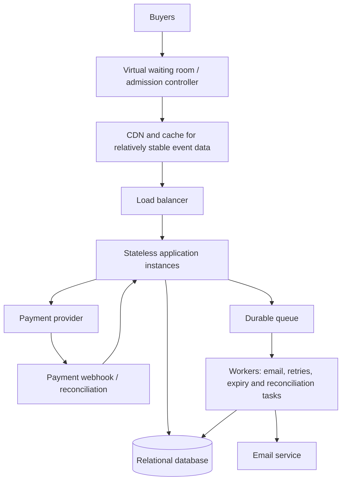

# TicketHub System Design

> **Status:** Working draft for the Day 8 assignment. This records the reasoning completed so far; estimates and design choices are assumptions to revisit as the design develops.

## 1. Requirements

### Functional requirements

1. Users can register or sign in and browse events.
2. Users can view event details and seat availability.
3. Authenticated users can request temporary holds on available seats.
4. Users can pay for valid holds and receive confirmed orders and tickets.
5. Users can view their purchased tickets and order status.
6. Expired, unpaid holds can be released when it is safe to do so.
7. Payment outcomes are recorded without creating duplicate orders or ticket allocations.

### Non-functional requirements

- **Correctness:** A seat must not have two simultaneous valid allocations or two confirmed sales.
- **Speed:** Browsing and seat availability should remain responsive during high demand. Specific latency targets still need to be proposed.
- **Fairness:** Sale access rules should be published and applied consistently. A waiting room can manage high-demand access, but cannot guarantee everyone gets a seat.
- **Reliability:** Confirmed orders must survive email-delivery failures and recover from delayed or duplicated payment notifications.
- **Security:** Authenticate buyers, authorize access to their own orders, validate input, and protect payment-related operations.
- **Scalability:** Handle normal traffic and a large sale without overwhelming the application, database, or payment integration.

## 2. Traffic and capacity estimates

### Given facts

- 2,000,000 registered users.
- 50,000 visitors on a normal day.
- 10 pages viewed per normal-day visitor.
- 5,000 tickets sold on a normal day.
- During a popular sale, 200,000 people try to buy 20,000 seats within 10 minutes.

### Normal-day page views

Total page views:

50,000 visitors × 10 pages = **500,000 page views/day**

Average rate across 24 hours:

500,000 ÷ 86,400 seconds/day ≈ **5.79 page views/second**

This is a daily average, not a peak rate.

### Popular-sale estimate

**Working assumptions to validate:**
- Average of 3 page views per sale participant.
- Average of 2 API requests per page.
- 10-minute sale window = 600 seconds.
- For this first estimate, arrivals and activity are averaged evenly across the window.

Estimated page views:

200,000 participants × 3 pages = **600,000 page views**

Average page-view rate:

600,000 ÷ 600 seconds = **1,000 page views/second**

Estimated API requests:

600,000 page views × 2 requests/page = **1,200,000 API requests**

Average API request rate:

1,200,000 ÷ 600 seconds = **2,000 API requests/second**

The sale page-view rate is about 173 times the normal daily average (1,000 ÷ 5.79). If normal traffic also averages two API requests per page, the normal average would be approximately 11.6 API requests/second, making the estimated sale API rate about 173 times higher under those assumptions.

**Important limitations:** These are estimates, not measured traffic or a capacity guarantee. Buyers may arrive in bursts, different pages generate different numbers of API requests, and retries can increase load. Load testing and production monitoring would be needed to establish safe capacity. Do not compare page views directly with API requests unless the relationship between them is stated.

### Workload types

- **Mostly reads:** browse events, view event details, request seat availability, view tickets.
- **State-changing operations:** create a seat hold, create an order, initiate or record payment, confirm an allocation, release an expired hold.
- Read requests are not all equally cacheable. Event descriptions are relatively stable; seat availability is time-sensitive. A cache must never be the final authority for allocating a seat.

## 3. API design — initial proposal

These are proposed endpoints, not implemented endpoints.

| Method | Endpoint | Purpose |
|---|---|---|
| GET | `/api/v1/events` | Browse events |
| GET | `/api/v1/events/{eventId}` | View event details |
| GET | `/api/v1/events/{eventId}/seats` | View seat availability |
| POST | `/api/v1/events/{eventId}/holds` | Request temporary seat holds |
| POST | `/api/v1/orders` | Create an order from a valid hold |
| POST | `/api/v1/orders/{orderId}/payment` | Initiate payment |
| GET | `/api/v1/me/tickets` | View the authenticated user's tickets |

### API concepts to remember

- The frontend sends HTTP requests; the API defines the contract for those requests and responses.
- The backend validates requests, applies business rules, and coordinates persistence and external services.
- The database stores authoritative records and enforces integrity constraints.
- A `GET` retrieves information. A `POST` submits data or requests an operation.
- A seat shown as available in the UI is not guaranteed to remain available. The hold endpoint must recheck availability and claim the seat safely.
- A retry of a payment or order request must not accidentally create a duplicate. Idempotency keys and idempotent payment-notification handling are likely design requirements.
- Example responses to specify later include `201 Created` for a successful hold and `409 Conflict` when a seat is already held or sold. Payment may remain pending rather than being confirmed synchronously.

## 4. Data model — initial proposal

The required core entities are:

- **users:** buyer identity and account information.
- **events:** event name, venue, date/time, and sale information.
- **seats:** seats belonging to an event, with identifiers and allocation state.
- **orders:** buyer, order status, totals, and purchase lifecycle.

A more flexible design will likely need an **order_items** table to represent each seat in an order, and possibly a **payment_attempts** table to record provider references and payment states. These additions need to be designed and justified in the next iteration.

Relationships to refine:
- One user can have many orders.
- One event has many seats.
- One order can contain one or more order items.
- Each order item refers to a specific seat.

## 5. Preventing double-booking — key design principle

A frontend check or a cached availability result is not enough. Two buyers can see a seat as available at almost the same time.

The database must be the authority for allocating seats. A transaction with row locking or an atomic conditional update can allow only one competing request to claim a seat. Constraints should protect the invariant that a seat cannot be allocated to two active holds or confirmed orders.

### Simplified seat lifecycle

`AVAILABLE → HELD → SOLD`

An eligible expired or released hold can return to `AVAILABLE`, but only after the system verifies that no successful or unresolved payment makes release unsafe.

A **five-minute hold** is a proposed starting assumption, not a requirement supplied by the assignment. The final design must explain how expiry is enforced, how pending payments are reconciled, and how late or duplicated payment notifications are handled.

Do not keep a database transaction open while waiting for an external payment provider. Claim the seat in a short transaction, process payment through a controlled workflow, and finalize or release the reservation according to explicit state transitions.

## 6. High-level architecture — initial proposal

### Responsibilities

- **Virtual waiting room/admission controller:** manages sale access and limits admission according to policy and system capacity.
- **CDN/cache:** reduces repeated work for relatively stable public event data. Cached seat availability can become stale and must not authorize a purchase.
- **Load balancer:** distributes requests across application instances.
- **Stateless application instances:** handle API requests and apply business rules without depending on private per-instance state.
- **Relational database:** stores authoritative seats, holds, orders and payment states; protects seat-allocation invariants with transactions and constraints.
- **Payment provider:** processes payment externally; responses can be delayed, fail, or arrive through webhooks.
- **Durable queue and workers:** handle recoverable asynchronous work, such as sending email and reconciling pending payments. A queue does not make an unavailable provider respond faster.
- **Email service:** sends confirmations after the order is confirmed. Email delivery must not determine whether a purchase succeeded.

The architecture is provisional. Components should remain only if the requirements or estimates justify them.

## 7. Trade-offs identified so far

### Trade-off 1: Randomized waiting-room admission vs strict first-come-first-served

A randomized order within a clearly defined entry window can reduce the advantage of arriving a fraction of a second earlier, but it does not guarantee that admitted buyers are ready to purchase. Strict first-come-first-served is easier to explain but can be influenced by connection latency and arrival timing. The policy must be published and applied consistently.

### Trade-off 2: Longer seat holds vs inventory availability

A longer hold gives buyers more time to pay, but keeps seats unavailable to other buyers for longer. A shorter hold releases inventory sooner but may cause legitimate buyers to lose seats during checkout. Five minutes is a provisional starting point to evaluate against payment behaviour.

### Trade-off 3: Caching vs fresh seat availability

Caching event descriptions can reduce load with relatively low risk. Caching seat availability reduces load too, but can display stale information. The database must still revalidate and atomically claim the seat when a hold is requested.

### Trade-off 4: Immediate confirmation vs resilient asynchronous processing

Waiting for every downstream action can make the checkout experience slower and couple the purchase to email delivery. Asynchronous confirmation work improves recovery, but requires clear pending states, durable records, idempotency, and reconciliation.

## 8. Open questions for the next iteration

- What latency targets should apply to event browsing and seat holds?
- What is the final waiting-room policy and how is admission capacity controlled?
- How are duplicate queue entries and automated abuse prevented?
- What exact database constraints and transaction steps enforce exclusive seat allocation?
- How are payment timeouts, delayed webhooks, retries and late success handled?
- What is the final relational schema, including order items and payment attempts?
- Which metrics and load tests demonstrate that the architecture can handle the estimated sale traffic?
- Which components are justified for the assignment's scope, and which are future scaling options?
